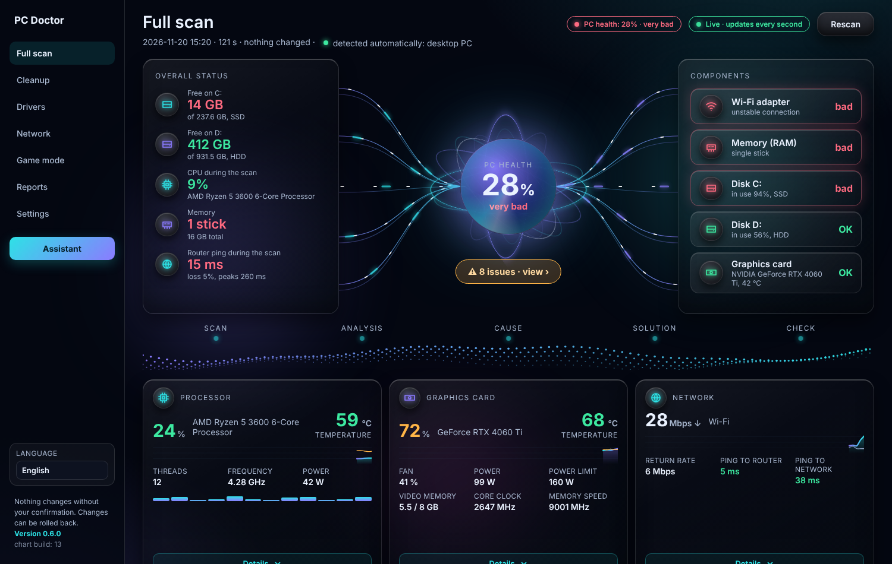
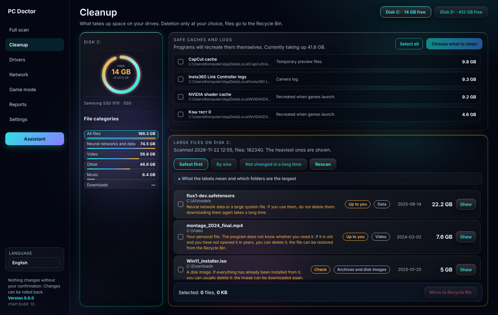
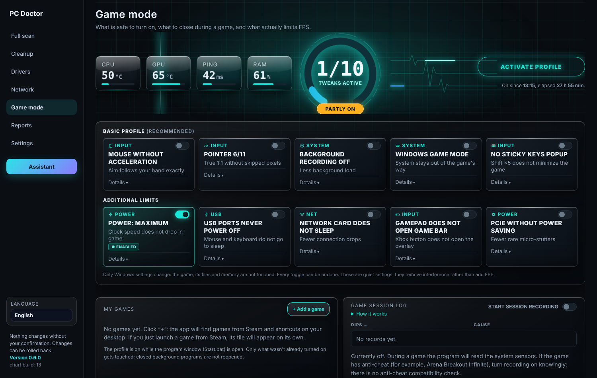

# PC Doctor (бета)

[English](README.md) · **Русский**

Программа для Windows 11: проверка компьютера, живые датчики, безопасная очистка диска и настройка Windows под игры.
Работает локально и ничего не отправляет в интернет (кроме необязательного помощника с вашим собственным ключом).

*На скриншотах демонстрационные данные. Интерфейс по умолчанию английский, русский включается в настройках.*

## Что умеет
- **Полная проверка:** диски, память, процессор, видеокарта, сеть, драйверы, батарея (ноутбуки). Тип (ПК или ноутбук) определяется сам.
- **Живые датчики** раз в секунду: нагрузка, температуры, частоты, вентиляторы, диски, сеть, пинг.
- **Безопасная очистка:** выбор диска, поиск больших файлов с полным путём, удаление только в Корзину (навсегда не удаляет). У каждого файла цветная метка (зелёная / жёлтая / красная), список идёт от безопасных к рискованным. Игровые файлы защищены полностью.
- **Игровой режим:** план питания, энергосбережение USB и сетевой карты, ускорение мыши, окно залипания клавиш, Game Bar, энергосбережение PCIe. Каждый тумблер откатывается. Пока идёт игра, программа сама снижает свой приоритет.
- **Драйверы и сеть:** пошаговые советы, решаете вы.
- **Отчёты:** журнал всех изменений с кнопкой «Откатить» и история проверок.
- **Помощник:** отвечает по вашему отчёту. Без ключа работает по правилам, с вашим ключом Anthropic API отвечает на свободные вопросы.
- **Языки:** английский по умолчанию, русский в настройках (польский, украинский и немецкий частичные).

| Очистка | Игровой режим |
|---|---|
|  |  |

> **Бета-версия.** Программа перемещает файлы в Корзину и меняет настройки Windows, поэтому требует прав администратора.
> Перед очисткой смотрите на цвет метки у каждого файла и не удаляйте то, в чём не уверены.
> Используйте на свой риск: программа предоставляется «как есть», без гарантий.

## Как запустить
1. Скачайте архив из раздела **Releases** и распакуйте **весь** архив в отдельную папку (не запускайте из архива).
2. Запустите `Start.bat` (полная проверка, 1-3 минуты) или `Live.bat` (сразу открывает последний отчёт) и согласитесь на запрос прав администратора.
3. Страница откроется в браузере по адресу `127.0.0.1` (только ваш компьютер). Закройте чёрное окно, чтобы остановить программу: вентиляторы и игровые настройки вернутся сами.

Если Windows пишет, что «защитила ваш компьютер»: *Подробнее → Выполнить в любом случае*. Программа пока не подписана цифровой подписью.
Подробная инструкция: [README-ru.txt](README-ru.txt).

## Чего программа не делает
- Не чистит реестр, не трогает службы и файлы игр, не ставит драйверы.
- Ничего не меняет без вашего подтверждения.

## Лицензия
Бесплатно для личного и некоммерческого использования. **Коммерческое использование (например, в фирме), распространение программы и публикация изменённых версий запрещены.**
Полные условия: [LICENSE](LICENSE) (PolyForm Strict 1.0.0). Сторонние библиотеки и их лицензии: [THIRD-PARTY.txt](THIRD-PARTY.txt).

## Поддержать автора
Если программа помогла, можно поддержать разработку донатом: **[PayPal](https://www.paypal.me/50NlC)**
<!-- Если ссылка PayPal.Me изменится, замените её здесь и в .github/FUNDING.yml. -->

## Нашли ошибку?
Откройте **Issues** и опишите, что произошло. Не прикладывайте файлы со своими путями и именем пользователя.
