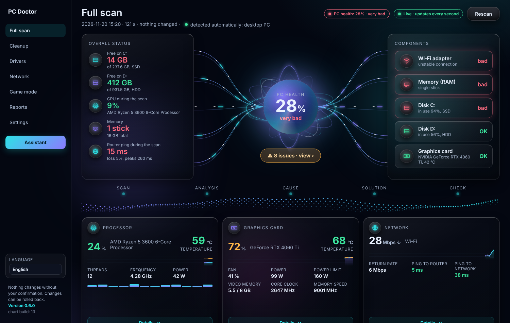
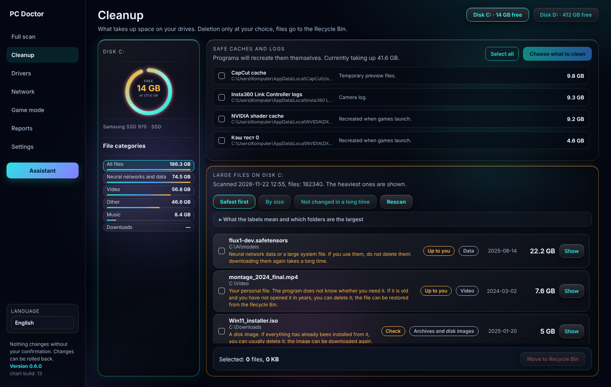
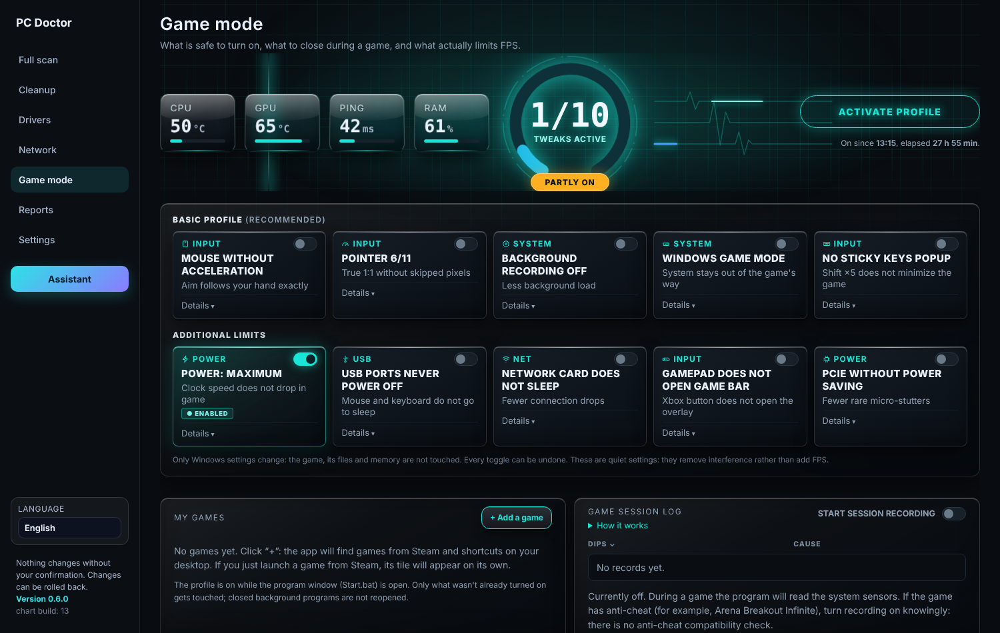

# PC Doctor (beta)

**English** · [Русский](README-ru.md)

A Windows 11 tool that checks your PC, shows live sensors, cleans the disk safely and tunes Windows for games.
It works locally and sends nothing to the internet (the only exception is the optional assistant, which uses your own API key).

*Screenshots use demo data.*

## Features
- **Full scan:** disks, memory, CPU, GPU, network, drivers, battery (laptops). PC or laptop is detected automatically.
- **Live sensors** once per second: load, temperatures, clocks, fans, disks, network, ping.
- **Safe cleanup:** pick a drive, find large files with full paths, and move them to the Recycle Bin only (never permanent deletion). Every file has a colour label (green / yellow / red), and the list is sorted safest first. Game files are fully protected.
- **Game mode:** power plan, USB and network-adapter power saving, mouse acceleration, Sticky Keys popup, Game Bar, PCIe power saving. Every toggle can be undone. The program lowers its own priority while a game runs.
- **Drivers and Network:** step-by-step advice. You decide what to change.
- **Reports:** a log of every change with an Undo button, plus the scan history.
- **Assistant:** answers from your report. It works by rules without a key; with your own Anthropic API key it can answer free-form questions.
- **Languages:** English by default, Russian in Settings (Polish, Ukrainian and German are partial).

| Cleanup | Game mode |
|---|---|
|  |  |

> **Beta software.** The program moves files to the Recycle Bin and changes Windows settings, so it asks for administrator rights.
> Before cleaning, read the colour label of each file and do not delete anything you are unsure about.
> Use it at your own risk: it is provided "as is", without warranty.

## How to run
1. Download the archive from **Releases** and extract the **whole** archive into its own folder (do not run it from inside the archive).
2. Run `Start.bat` (full scan, 1-3 minutes) or `Live.bat` (opens the last report right away) and accept the administrator prompt.
3. The page opens in your browser at `127.0.0.1` (this computer only). Close the black window to stop the program; fans and game settings are restored automatically.

If Windows says it "protected your PC", click *More info → Run anyway*. The program is not code-signed yet.
A detailed guide in Russian: [README-ru.txt](README-ru.txt).

## What it does not do
- It does not clean the registry, touch services or game files, or install drivers.
- It changes nothing without your confirmation.

## License
Free for personal and non-commercial use. **Commercial use (for example, in a company) is not allowed, and neither is redistributing the program or publishing modified versions.**
Full terms: [LICENSE](LICENSE) (PolyForm Strict 1.0.0). Third-party libraries and their licenses: [THIRD-PARTY.txt](THIRD-PARTY.txt).

## Support the author
If the program helped you, you can support its development with a donation: **[PayPal](https://www.paypal.me/50NlC)**
<!-- Replace the link above and in .github/FUNDING.yml if your PayPal.Me handle changes. -->

## Found a bug?
Open an **Issue** and describe what happened. Please do not attach files that contain your paths or user name.
